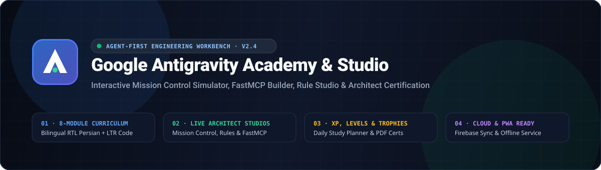

<div align="center">

[](https://antigravity.google/docs)

<br />

# Google Antigravity Academy & Mission Control Studio

### The Comprehensive Interactive Workbench, Agent-First Simulator & Architecture Masterclass

[](https://www.typescriptlang.org/)
[](https://react.dev/)
[](https://tailwindcss.com/)
[](https://d3js.org/)
[](https://firebase.google.com/)
[](https://web.dev/progressive-web-apps/)
[](./.github/workflows/main.yml)
[](./LICENSE)

<p align="center">
  <strong>An elite developer platform and interactive engineering workbench dedicated to mastering Agent-First Systems, Multi-Agent Orchestration, and Autonomous IDE Workflows with <a href="https://antigravity.google/docs">Google Antigravity</a>.</strong>
</p>

<!-- Quick Navigation Action Badges -->
<p align="center">
  <a href="#-local-development-guide-step-by-step">
    
  </a>
  <a href="#-key-features--workbench-capabilities">
    
  </a>
  <a href="#-structured-technology-stack-summary">
    
  </a>
  <a href="#-8-module-engineering-curriculum">
    
  </a>
  <a href="#-interactive-studios--simulators">
    
  </a>
  <a href="./CONTRIBUTING.md">
    
  </a>
</p>

</div>

---

## 🌌 Overview

**Google Antigravity Academy & Mission Control Studio** is an open-source, production-grade educational platform and hands-on engineering simulator built for **Principal AI Systems Architects, Staff Engineers, and Engineering Leaders** making the paradigm leap from synchronous, line-by-line copilot autocompletions to **Asynchronous, Artifact-Driven Multi-Agent Engineering**.

Rather than presenting static documentation walls, this workbench provides a live, telemetry-rich environment to **simulate, configure, audit, and benchmark** real-world Antigravity development flows:
- **Dual-View Ergonomics:** Mastering the interaction boundary between real-time **Editor View** (`Supercomplete`, `Tab-to-Jump`, `Inline Command`) and asynchronous **Agent Manager** orchestration.
- **Audit-First Artifact Lifecycles:** Enforcing explicit verification gates via structured `task.md`, `implementation_plan.md`, and `walkthrough.md` files.
- **Strict Context Engineering:** Designing `.agent/rules/*.md` and `.agent/workflows/*.md` to prevent Context Rot and optimize token budgets.
- **Enterprise Integrations:** Visual configuring of the Model Context Protocol (**MCP**), Python `FastMCP` servers, and parallel Git Worktree pipelines.

---

## 🛠️ Structured Technology Stack Summary

The following matrix outlines the production technologies, versions, and architectural responsibilities that power the workbench:

| Architectural Layer | Technology / Framework | Version | Core Role & Responsibility |
| :--- | :--- | :--- | :--- |
| **Frontend Framework** | [React](https://react.dev/) | `^19.0.0` | Reactive UI, concurrent rendering, and hooks-based state management |
| **Language & Typing** | [TypeScript](https://www.typescriptlang.org/) | `~5.8.2` | Strict end-to-end type safety across client, server, and curriculum data |
| **Styling & Design System** | [Tailwind CSS v4](https://tailwindcss.com/) | `^4.0.0` | Zero-runtime CSS, dark/light glassmorphic UI, and bidirectional RTL/LTR layout |
| **Data Visualization Engine** | [D3.js](https://d3js.org/) | `^7.9.0` | 52-week calendar heatmaps and concept tag bubble co-occurrence graphs |
| **Backend & Development** | [Express 4](https://expressjs.com/) + [Vite 6](https://vite.dev/) | `^4.21.2` / `^6.2.0` | Full-stack proxy, Gemini API integration, and lightning-fast build pipeline |
| **Persistence & Cloud Sync** | [Firebase Firestore & Auth](https://firebase.google.com/) | `^11.4.0` | User telemetry backup, Google authentication, and zero-trust security rules |
| **Offline Engine & PWA** | [Vite PWA (Workbox)](https://vite-pwa-org.netlify.app/) | `^0.21.1` | Service worker caching, offline asset fallback, and desktop/mobile installability |
| **Motion & Micro-Interactions** | [Motion (Framer)](https://motion.dev/) | `^12.4.7` | Fluid layout transitions, modal overlays, and interactive stepper animations |
| **Iconography** | [Lucide React](https://lucide.dev/) | `^1.16.0` | Crisp, accessible SVG iconography across all navigation and studio views |
| **Unit Testing Framework** | [Node.js Test Runner](https://nodejs.org/api/test.html) + [tsx](https://github.com/privatenumber/tsx) | Native / `^4.19.3` | Decoupled pure-logic unit testing with zero runtime overhead |
| **Security & Quality Auditing** | [ESLint](https://eslint.org/) + [@firebase/security-rules](https://www.npmjs.com/package/@firebase/eslint-plugin-security-rules) | `^9.21.0` | AST validation and automated security auditing for `firestore.rules` |

---

## 🏛️ System Architecture

The application runs as a cohesive full-stack TypeScript workspace pairing an Express.js API proxy with Vite 6, React 19, Tailwind CSS v4, D3.js interactive telemetry, and Firebase Cloud Firestore:

```text
┌────────────────────────────────────────────────────────────────────────────────────────┐
│                                   CLIENT SPA (React 19)                                │
│                                                                                        │
│  ┌─────────────────────────┐  ┌───────────────────────────┐  ┌──────────────────────┐  │
│  │ 8-Module Curriculum UI  │  │ 3 Interactive Studios     │  │ Achievements & Rank  │  │
│  │ • Editor vs Agent Mgr   │  │ • Mission Control PR Sim  │  │ • Mastery Ranks      │  │
│  │ • Artifact Workflows    │  │ • Rule & Workflow Studio  │  │ • Daily Study Timer  │  │
│  │ • Terminal & Autonomy   │  │ • Enterprise FastMCP Bldr │  │ • Rare Trophy Case   │  │
│  └───────────┬─────────────┘  └─────────────┬─────────────┘  └──────────┬───────────┘  │
│              │                              │                           │              │
│  ┌───────────┴──────────────────────────────┴───────────────────────────┴───────────┐  │
│  │                   D3.js Data Telemetry & Analytics Engine                        │  │
│  │     • 52-Week Activity Heatmap  • Concept Tag Co-occurrence Bubble Graph        │  │
│  └──────────────────────────────────────────┬───────────────────────────────────────┘  │
│                                             │                                          │
│  ┌──────────────────────────────────────────┴───────────────────────────────────────┐  │
│  │   Offline Engine (PWA Workbox)   │   Client Data Layer (LocalStorage & JSON IO)  │  │
│  └──────────────────────┬───────────────────────────────────┬───────────────────────┘  │
└─────────────────────────┼───────────────────────────────────┼──────────────────────────┘
                          │                                   │
                          ▼                                   ▼
          ┌───────────────────────────────┐   ┌───────────────────────────────┐
          │  Express 4 + Vite Full-Stack  │   │  Firebase Firestore & Auth    │
          │  • /api/antigravity/assistant │   │  • ABAC Zero-Trust Rules      │
          │  • Gemini 3.8 Flash Proxy     │   │  • Cross-Device Cloud Sync    │
          │  • Live Search Grounding      │   │  • Elevated Security Guard    │
          └───────────────────────────────┘   └───────────────────────────────┘
```

---

## ✨ Key Features & Workbench Capabilities

### 1. 📖 Unabridged 8-Module Curriculum
Full technical depth covering the complete specification of `antigravity.google/docs` with zero placeholders, interactive code sandboxes (Python Async, TypeScript, SQL, Bash), and architecture comparison matrices.

### 2. 🎛️ 3 Interactive Mission Control Studios + 8 Production Scenarios
- **Mission Control & PR Review Simulator:** Run a simulated 4-stage asynchronous agent execution pipeline, review diffs, attach inline audit comments to `implementation_plan.md`, and verify Chromium visual telemetry.
- **Rule, Workflow & Guardrail Studio:** Build `.agent/rules/*.md` with 4 activation modes (`Always On`, `Glob`, `Model Decision`, `Manual`) and `.agent/workflows/*.md` with `// turbo` directives, featuring a live **Context Window Token Overhead** calculator.
- **Enterprise FastMCP Server Builder:** Visually configure connectors (PostgreSQL, GitHub Enterprise, OpenSearch, Rocket.Chat) to generate valid `mcp_config.json` and production Python `FastMCP` server code.

### 3. 📊 D3.js Data Visualizations
- **52-Week Yearly Calendar Heatmap:** Visualizes daily knowledge base usage frequency and research velocity over the past year.
- **Concept Tag Bubble Graph:** Interactive D3 force-directed tag pack demonstrating engineering concept relationships, occurrence counts, and co-occurrence clusters.

### 4. 🔍 Full-Text Search & Live Tag Filtering
Instant real-time search across the entire knowledge base with substring content matching and a multi-category dropdown filter to isolate topics by engineering domain.

### 5. 🎖️ Mastery Rank System & Gamification
- **Mastery Ranks:** Four progressive titles (`Trainee` → `Specialist` → `Architect` → `Principal`) calculated deterministically from accumulated XP and completed milestones.
- **Streak Tracker:** Real-time consecutive study streak counter with automatic milestone badges at **7**, **30**, and **100** days.
- **Daily Planner & Timer:** Customizable target study sessions with an active `MM:SS` timer and weekly target ratio visualization.
- **Trophy Case:** Digital trophies spanning Common, Rare, Epic, Legendary, and Mythic tiers.

### 6. 💾 Bulk Data Management & Backup Engine
One-click JSON bulk export of learning history, unlocked badges, and accumulated XP for external backup, sharing, or migration between development environments.

### 7. 📄 Scoped On-Demand PDF Export Engine
Export any chapter, cheat sheet, generated configuration, or report card as a clean, high-contrast, print-optimized standalone PDF.

### 8. ☁️ Cloud Firestore Persistence & Google Auth
Seamless cloud backup for learning telemetry backed by hardened Attribute-Based Access Control (`firestore.rules`) and verified via `@firebase/eslint-plugin-security-rules`.

### 9. 📲 Installable Offline-First PWA
Complete Progressive Web App with custom service worker caching (Workbox), custom vector emblems, offline fallback indicator, and desktop/mobile installability.

---

## 📚 8-Module Engineering Curriculum

| Module | Chapter Title | Core Engineering Concepts | Artifacts & Output |
| :---: | :--- | :--- | :--- |
| **01** | **Core Architecture: Editor View vs. Agent Manager** | Synchronous Copilot era vs. Asynchronous Agent-First orchestration | `Supercomplete`, `Tab-to-Jump`, `Cmd/Ctrl + I`, `@file` / `@rule` / `@mcp` |
| **02** | **Artifact-Driven Engineering & Inline Auditing** | Audit-first development loops and structured verification gates | `task.md`, `implementation_plan.md`, `walkthrough.md`, Inline PR Review |
| **03** | **Execution Modes, Terminal Policies & Autonomy** | Balancing velocity with safety in automated terminal operations | `Planning` vs. `Fast Mode`, Terminal `Off`/`Auto`/`Turbo`, Command Allow/Deny Lists |
| **04** | **Context Engineering & `.agent/rules` Architecture** | Eliminating Context Rot and enforcing codebase invariants | `.agent/rules/*.md`, YAML Frontmatter, 4 Activation Modes |
| **05** | **Workflows, Slash Commands & Turbo Pipelines** | Standardizing repeatable team procedures and zero-friction commands | `.agent/workflows/*.md`, `/safe-migration`, `// turbo`, `// turbo-all` |
| **06** | **Browser Subagent & Visual E2E Telemetry** | Automated browser verification and frontend visual regression testing | Headless Chromium AXTree, Network Interception, `WebP` Visual Proof |
| **07** | **Enterprise Model Context Protocol (MCP) & FastMCP** | Standardized tool and data integration for enterprise infrastructure | `mcp_config.json` (`stdio`/`sse`), Python `FastMCP` (`@mcp.tool`, `@mcp.resource`) |
| **08** | **Multi-Agent Orchestration, Git Worktrees & ROI** | Scalable agent parallelism, knowledge curation, and engineering economics | Parallel `Git Worktrees`, `Inbox` Triage, Persistent Knowledge Base, Zero Context Rot |

---

## 💻 Local Development Guide (Step-by-Step)

Follow this step-by-step guide to clone, install dependencies, configure, test, and run the complete workbench locally on your machine.

### Step 1: System Prerequisites

Ensure you have the following installed on your operating system:
- **Node.js:** Version `20.0.0` or higher (recommended: `22.x LTS`)
- **npm:** Version `10.0.0` or higher
- **Git:** Version `2.30+`
- **Modern Web Browser:** Chrome, Chromium, Edge, Firefox, or Safari

Verify your environment by running:
```bash
node -v   # Should output v20.x.x or higher
npm -v    # Should output 10.x.x or higher
git --version
```

---

### Step 2: Clone the Repository

Clone the project repository to your local machine and navigate into the root directory:

```bash
git clone https://github.com/<your-username>/google-antigravity-academy-studio.git
cd google-antigravity-academy-studio
```

---

### Step 3: Install Dependencies

Install all production and development dependencies using `npm install`:

```bash
npm install
```

> **Note:** This installs all core libraries including React 19, Vite 6, Tailwind CSS v4, Express, D3.js, Firebase, Motion, Lucide icons, and the ESLint security rule plugins.

---

### Step 4: Configure Environment Variables

The project includes an `.env.example` file with documented variable definitions:

1. Copy the example environment file to `.env`:
   ```bash
   cp .env.example .env
   ```

2. *(Optional)* Configure your Google Gemini API Key:
   Open `.env` in your editor:
   ```ini
   # Optional: Enables real-time AI assistant search grounding via Google GenAI SDK.
   # If left empty, the built-in offline architectural knowledge base serves responses gracefully.
   GEMINI_API_KEY="your-gemini-api-key-here"

   # App hosting URL (defaults to http://localhost:3000 in local development)
   APP_URL="http://localhost:3000"
   ```

3. **Firebase Cloud Configuration:**
   - The repository comes pre-bundled with a ready-to-use development configuration in `firebase-applet-config.json`.
   - The application functions **100% offline-first** using `localStorage` even without an active internet connection.
   - If you want to connect your own Firebase project, simply update the fields in `firebase-applet-config.json` with your project's credentials.

---

### Step 5: Start the Development Server

Start the full-stack Express + Vite development server:

```bash
npm run dev
```

You should see output similar to:
```text
🚀 Antigravity Full-Stack Server listening on http://localhost:3000
   Express API routes mounted at /api/antigravity/*
   Vite client SPA mounted with HMR disabled
```

Open your browser and navigate to:
👉 **`http://localhost:3000`**

---

### Step 6: Run Automated Tests

The repository includes a comprehensive unit test suite leveraging Node.js native test runner (`node:test`) and `tsx`. The tests validate all pure generators, token overhead calculators, D3 data structures, Mastery Rank calculations, and Cloud Firestore security rules.

Run the test suite:
```bash
npm test
```

Expected test result:
```text
✔ Firestore security rules enforce all 8 hardened pillars and reject Dirty Dozen patterns
✔ buildRuleMarkdown generates valid Glob frontmatter and selected domain sections
✔ buildWorkflowMarkdown respects // turbo-all vs step-level // turbo directives
✔ recommendAutonomyPolicy enforces Request Review for enterprise-prod and destructive DB access
✔ buildMcpConfigJson and buildFastMcpPythonCode generate valid JSON and FastMCP tools
✔ estimateRuleTokenOverhead calculates lower per-turn cost for Glob than Always On
✔ calculateStreakSummary computes current consecutive streak and longest streak
✔ buildKnowledgeBaseYearlyCalendarHeatmap constructs 52-week D3 calendar heatmap
✔ searchKnowledgeBaseFullText filters knowledge items in real-time by title and content
✔ calculateMasteryRankStanding assigns Trainee, Specialist, Architect, and Principal ranks
...
1..26
# tests 26
# pass 26
# fail 0
```

---

### Step 7: Linting & Security Rule Auditing

Validate TypeScript types across the entire project:
```bash
npm run lint
```

Audit Cloud Firestore security rules for anti-patterns or logic vulnerabilities:
```bash
npx eslint firestore.rules
```

---

### Step 8: Production Build & Local Preview

To build the project for production deployment:

```bash
# 1. Compile the production bundle and generate the PWA service worker
npm run build

# 2. Test the compiled production build locally
npm start
```

The production server will serve the optimized bundle from the `dist/` directory at **`http://localhost:3000`**.

---

## 🛠️ Troubleshooting Local Setup

| Issue | Cause | Solution |
| :--- | :--- | :--- |
| **Port 3000 already in use** | Another process is occupying port 3000 | Find and terminate the process: <br />`lsof -ti :3000 \| xargs kill -9` or edit `PORT = 3000` in `server.ts`. |
| **`WebSocket closed without opened`** | HMR WebSocket connection blocked or disabled | Expected in containerized environments; HMR is intentionally set to `false` in `server.ts` to ensure stable runtime. |
| **Firebase offline warning** | Device is offline or project network sandbox blocks WebChannel | The app will automatically run in local mode; user progress, XP, and streaks are safely persisted in `localStorage`. |
| **Type errors during `npm run lint`** | Stale TypeScript build cache | Run `npx tsc --build --clean` followed by `npm run lint`. |
| **Service Worker not updating** | Browser cached previous PWA service worker | Open DevTools (`F12`), go to **Application > Service Workers**, and click **Unregister** or check **Update on reload**. |

---

## 📂 Project Structure

```text
├── .github/
│   └── workflows/
│       └── main.yml                         # GitHub Actions CI (Node 22, Install, Lint, Test, Build)
├── public/
│   ├── github-banner.svg                    # Repository banner graphic
│   ├── icon.svg                             # Scalable application emblem
│   └── pwa-*.png / apple-touch-icon.png     # PWA icons and app store manifests
├── src/
│   ├── components/
│   │   ├── AchievementsCertificationView.tsx # Mastery Ranks, XP Engine, Daily Streak & Cloud Sync
│   │   ├── CodeAndPdfTools.tsx              # Syntax-highlighted code blocks & Scoped PDF export
│   │   ├── GlobalSearchAndAiCopilot.tsx     # Cmd+K Instant search modal & Gemini assistant
│   │   ├── KnowledgeBaseExplorer.tsx        # D3 Yearly Heatmap, Tag Bubble Graph & Full-Text Search
│   │   ├── ModuleContentView.tsx            # Interactive curriculum reader, matrices & TOC
│   │   └── PWAInstallAndOffline.tsx         # PWA install prompt & offline status indicator
│   ├── data/
│   │   ├── modulesPart1.ts                  # Modules 01–04 full curriculum data
│   │   ├── modulesPart2.ts                  # Modules 05–08 full curriculum data
│   │   └── curriculumIndex.ts               # Search index, case studies & cheat sheets
│   ├── lib/
│   │   └── firebase.ts                      # Firebase SDK init, Google Auth & Firestore client
│   ├── studios/
│   │   ├── MissionControlSimulator.tsx      # 4-stage agent pipeline & inline PR review simulator
│   │   ├── GuardrailAutomationStudio.tsx    # .agent/rules & .agent/workflows generator
│   │   └── McpCheatSheetScenarioStudios.tsx # Visual FastMCP server builder & cheat sheets
│   ├── utils/
│   │   ├── achievements.ts                  # Pure logic: Mastery Ranks, XP, Streak milestones, D3 maps
│   │   ├── generators.ts                    # Pure logic: Rule, Workflow, FastMCP & Token generators
│   │   └── generators.test.ts               # Automated unit tests (node:test)
│   ├── App.tsx                              # Main layout, router, navigation bar & modal host
│   ├── index.css                            # Tailwind CSS v4 configuration & bidirectional typography
│   └── main.tsx                             # React 19 application entry point
├── .env.example                             # Environment variable template
├── firebase-blueprint.json                  # Firestore data schema intermediate representation (IR)
├── firestore.rules                          # Hardened 8-Pillar Cloud Firestore security rules
├── firestore.rules.test.ts                  # Security rule invariant unit tests
├── package.json                             # Project dependencies and executable npm scripts
├── server.ts                                # Express 4 full-stack server with Vite middleware
├── tsconfig.json                            # TypeScript strict configuration
└── vite.config.ts                           # Vite 6 + Tailwind CSS v4 + VitePWA configuration
```

---

## 🤝 Contributing

Contributions from the developer community are warmly welcomed! Whether you are adding a new architectural scenario, optimizing a D3 visualization, or expanding the curriculum:

1. **Review Guidelines:** Please review our **[`CONTRIBUTING.md`](./CONTRIBUTING.md)** for detailed instructions on code conventions, PR descriptions, and architectural standards.
2. **Fork & Branch:** Create a feature branch from `main`:
   ```bash
   git checkout -b feature/my-new-feature
   ```
3. **Write Unit Tests:** Ensure all pure logic is decoupled in `src/utils/` and covered by automated tests.
4. **Verify Standards:** Ensure all tests, lints, and builds pass before submitting a Pull Request:
   ```bash
   npm test && npm run lint && npm run build
   ```

---

## 📜 License

This project is licensed under the **Apache License 2.0**. See the [`LICENSE`](./LICENSE) file for the full license text.

---

<div align="center">

**Built with precision for the next generation of Agentic Software Architects.**  
*Official Google Antigravity Documentation: [antigravity.google/docs](https://antigravity.google/docs)*

</div>
