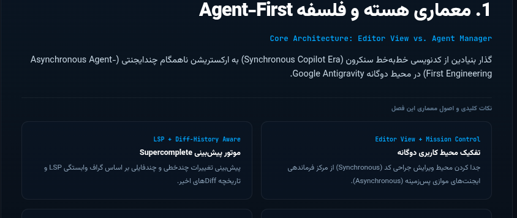
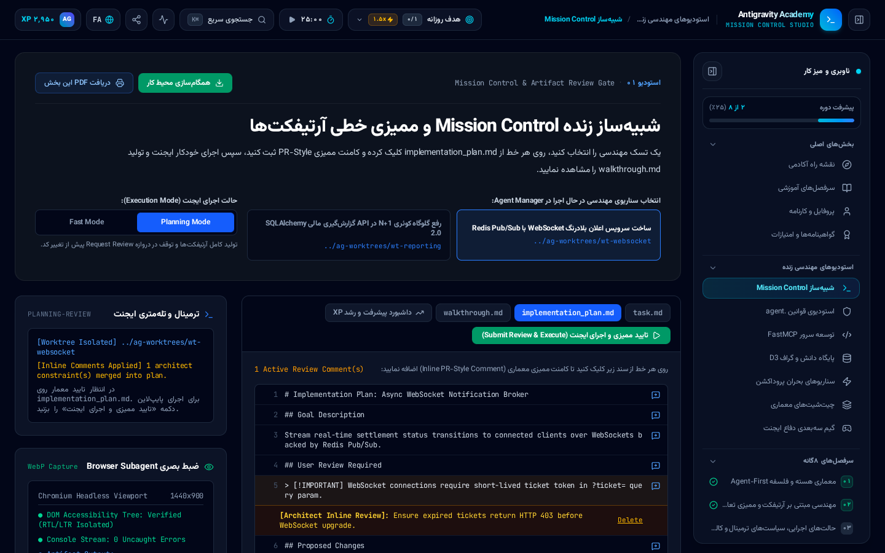
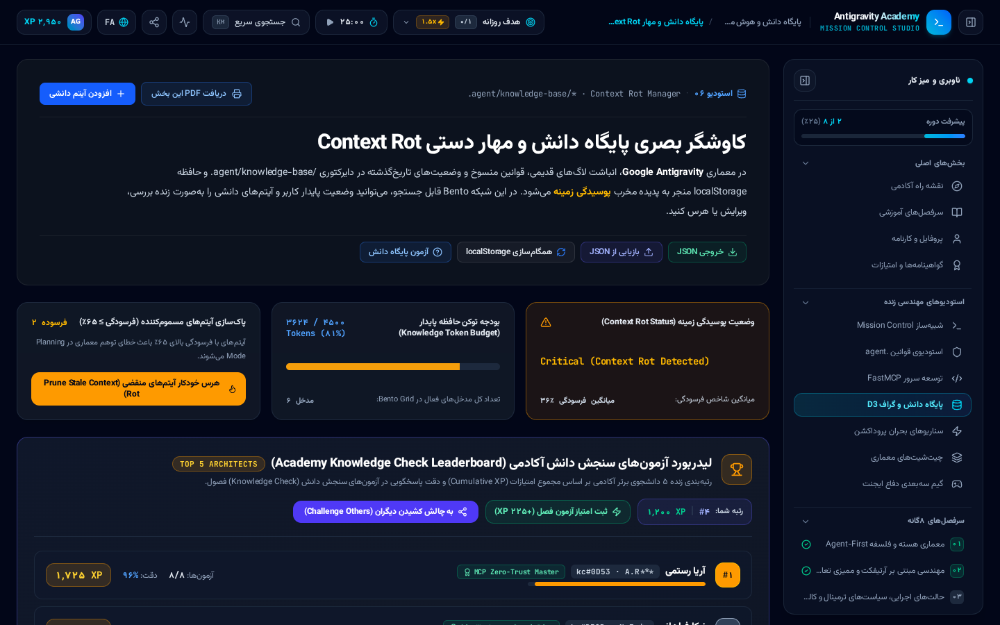

<div align="center">

[](https://antigravity.google/docs)

<br />

# Google Antigravity Academy & Mission Control Studio
### آکادمی جامع معماری نرم‌افزار ایجنت‌محور و اتاق فرمان تعاملی

[](https://www.typescriptlang.org/)
[](https://react.dev/)
[](https://tailwindcss.com/)
[](https://d3js.org/)
[](https://threejs.org/)
[](https://web.dev/progressive-web-apps/)
[](./src/utils/generators.test.ts)
[](./LICENSE)

<p align="center">
  <strong>An elite developer platform, architectural masterclass, and live engineering simulator designed to master Agent-First Systems, Deterministic Guardrails, FastMCP 2.0, and Autonomous Multi-Agent Workspaces with <a href="https://antigravity.google/docs">Google Antigravity</a>.</strong>
</p>

<!-- Quick Navigation Action Badges -->
<p align="center">
  <a href="#-quick-tour--visual-interface-showcase">
    
  </a>
  <a href="#-key-features--capabilities">
    
  </a>
  <a href="#-8-module-engineering-curriculum">
    
  </a>
  <a href="#-architect-profile--learning-transcript">
    
  </a>
  <a href="#-local-development--quickstart">
    
  </a>
  <a href="./CONTRIBUTING.md">
    
  </a>
</p>

</div>

---

## 🌟 معرفی پروژه (Project Overview)

پلتفرم **Google Antigravity Academy & Mission Control Studio** یک بستر آموزشی و شبیه‌ساز مهندسی سطح سازمانی (Enterprise-Grade) است که برای **معماران ارشد سیستم‌های هوش مصنوعی (Principal AI Systems Architects)، مهندسان ارشد و مدیران فنی** بازطراحی شده است تا تحول بنیادین از اتوکامپلیت‌های خط‌به‌خط (Copilot) به سمت **مهندسی ایجنت‌محور خودکار و مبتنی بر آرتیفکت** را محقق سازد.

> Moving from synchronous, line-by-line copilot completions to **Asynchronous, Artifact-Driven Multi-Agent Engineering**.

این سامانه به جای ارائه مستندات خشک متنی، یک محیط آزمایشگاهی کاملاً تعاملی با قابلیت اجرای زنده کد، ممیزی اسناد `task.md` و `implementation_plan.md`، مهار پوسیدگی زمینه (Context Rot)، تست پروتکل FastMCP 2.0 و ارکستریشن چندایجنتی روی شاخه‌های ایزوله Git Worktree فراهم آورده است.

---

## 🖼️ گشت بصری در محیط برنامه (Visual Interface Showcase)

### ۱. لندپیج جذاب آکادمی و نقشه راه جامع (Academy Landing Page & Roadmap)
نمای صفحه اصلی آکادمی شامل شمارنده‌های زنده تلمتری، سرفصل‌های ۸گانه دوره، استودیوهای تعاملی، جدول نخبگان و ماموریت‌های روزانه معمار:

<div align="center">
  
  <p><em>نمای لندپیج اختصاصی آکادمی: نقشه راه فازبندی‌شده، معرفی استودیوها، آزمون‌های تحلیلی و تابلوی نخبگان</em></p>
</div>

<br />

### ۲. شبیه‌ساز زنده اتاق فرمان و ممیزی آرتیفکت‌ها (Mission Control Simulator)
شبیه‌ساز محیط دوگانه **Editor View** و **Agent Manager** همراه با فرآیند ممیزی گیت‌های تایید انسان در حلقه (Human-in-the-Loop):

<div align="center">
  
  <p><em>شبیه‌ساز اتاق فرمان: اجرای دستورات زنده، بررسی تلمتری و ممیزی فایل‌های task.md و implementation_plan.md</em></p>
</div>

<br />

### ۳. استودیوی بصری FastMCP و گراف دانش پایدار D3 (FastMCP & Knowledge Base)
محیط توسعه سرورهای پایتون FastMCP 2.0، بازرس بسته‌های JSON-RPC و گراف خوشه‌ای مفاهیم همراه با هیت‌مپ ۵۲ هفته‌ای:

<div align="center">
  
  <p><em>استودیوی FastMCP و پایگاه دانش: هرس حافظه پوسیده (Context Rot)، بازرس JSON-RPC و نمودار حباب‌های تعاملی</em></p>
</div>

---

## ✨ ویژگی‌ها و قابلیت‌های کلیدی (Key Features & Capabilities)

### 🚀 ۱. لندپیج استاندارد و مدرن (Flagship Educational Landing Page)
- **هدر الهام‌بخش با تلمتری زنده:** نمایش ۴ آمار حیاتی آکادمی (۸ فصل تخصصی، ۴ استودیو، ۴۶+ تست خودکار و ۲,۹۰۰+ میانگین XP).
- **نقشه راه تعاملی فازبندی‌شده:** فیلتر بر اساس فاز ۱ (معماری هسته)، فاز ۲ (قوانین و کانتکست) و فاز ۳ (FastMCP و مقیاس‌پذیری).
- **ویترین استودیوهای تعاملی:** کارت‌های هدایت مستقیم به شبیه‌سازها با یک کلیک.
- **پیش‌نمایش جدول نخبگان آکادمی:** نمایش رده‌بندی برترین معماران همراه با شناسه‌های ایمن، امتیاز XP و دقت در کوییزها.
- **ماموریت روزانه معمار (Daily Mission):** تسک تصادفی معماری همراه با پاداش امتیاز XP جهت ارتقای استمرار مطالعه.

### 👤 ۲. پروفایل و کارنامه جامع تحصیلی (Architect Profile & Transcript)
- **کارت شناسنامه معمار:** نام قابل ویرایش (ذخیره پایدار در مرورگر)، شناسه رسمی، سطح مهارت و آواتار سفارشی.
- **پایش پیشرفت و XP:** نوار وضعیت ارتقا به سطح ۵ (Principal Architect) و نمایش استمرار مطالعه (Study Streak).
- **هیت‌مپ فعالیت سالانه (۵۲ هفته):** گرید سبک گیت‌هاب جهت رهگیری تعاملات روزانه، جلسات پومودورو و کوییزها.
- **مجموعه نشان‌ها و گواهینامه‌های رسمی:** نشان‌های قابل بازگشایی (Dual-Surface Pilot, Context Rot Sentinel, FastMCP 2.0 Architect, Quiz Grandmaster).
- **جدول ریزنمرات آزمون‌های سنجش مهارت (Knowledge Check Transcripts):** ثبت نمرات آزمون‌های ۳ سوالی هر ماژول با قابلیت آزمون مجدد.
- **خروجی استاندارد JSON:** امکان دانلود کارنامه با کد اعتبارسنجی یکتا (`antigravity-transcript-*.json`).

### 📚 ۳. سرفصل‌های ۸گانه معمار ارشد (8-Module Curriculum)
| شماره | عنوان فصل (Persian / English) | فاز | مدت زمان | مبحث کلیدی |
|---|---|---|---|---|
| **۰۱** | **معماری دوگانه ویرایشگر و مدیر**<br>Dual-Surface Architecture | فاز ۱ | ۱۵ دقیقه | مرز Editor View و Agent Manager |
| **۰۲** | **چرخه عمر آرتیفکت‌های تاییدپذیر**<br>Verifiable Artifact Lifecycles | فاز ۱ | ۲۰ دقیقه | گیت‌های ممیزی task.md و plan.md |
| **۰۳** | **امنیت ترمینال و ایزولاسیون دستورات**<br>Terminal Sandboxing & Guardrails | فاز ۱ | ۱۸ دقیقه | جلوگیری از فرامین مخرب `rm -rf` |
| **۰۴** | **قوانین ۴ حالته و مهار Context Rot**<br>4-Mode Rules & Context Hygiene | فاز ۲ | ۲۵ دقیقه | Always On, Glob, Model, Manual |
| **۰۵** | **پایپ‌لاین‌های اتوماسیون // turbo**<br>Deterministic Workflow Pipelines | فاز ۲ | ۲۲ دقیقه | دستورات بدون توقف توربو و SOP |
| **۰۶** | **عامل مرورگر و تلمتری بازرسی UI**<br>Browser Subagents & DOM Testing | فاز ۲ | ۳۰ دقیقه | تست‌های خودکار Playwright و کنسول |
| **۰۷** | **توسعه سرورهای FastMCP 2.0 در پایتون**<br>FastMCP 2.0 Server Development | فاز ۳ | ۳۵ دقیقه | JSON-RPC، ابزارهای سفارشی و منابع |
| **۰۸** | **ارکستریشن چندایجنتی روی Git Worktree**<br>Parallel Multi-Agent Worktrees | فاز ۳ | ۴۰ دقیقه | اجرای موازی چند ایجنت بدون کانفلیکت |

### 🛠️ ۴. استودیوهای تعاملی (Interactive Engineering Sandboxes)
- **Mission Control Simulator:** شبیه‌سازی زنده تبادل فرامین، تولید خودکار کد و ممیزی اسناد.
- **Rule & Workflow Studio:** طراحی قوانین `.agent/rules/*.md` و ارزیابی زنده ریسک دستورات در محیط‌های Sandboxed.
- **FastMCP Visual Studio:** تولید کد سرورهای پایتون با دکوراتورهای `@mcp.tool` و تولید فایل پیکربندی `mcp_config.json`.
- **Architect Scenario Lab:** ۸ سناریوی بحران در پروداکشن واقعی با تحلیل تریدآف و فیدبک تحلیلی.
- **Knowledge Base Explorer:** پایگاه دانش مبتنی بر D3 با نمودارهای خوشه‌ای و پالایش توکن‌ها.
- **3D Cyber Arena Defense Game:** شبیه‌ساز گیم سه‌بعدی WebGL با Three.js برای دفاع ایجنت در برابر حملات سایبری.

---

## 🛠️ ساختار ماژولار و مهندسی پروژه (Modular Architecture)

```
├── .env                  # متغیرهای محیطی محلی توسعه
├── .env-sample           # فایل نمونه متغیرهای استاندارد
├── .env.example          # فایل مستندسازی متغیرها برای کلود
├── public/               # دارایی‌های استاتیک، آیکون‌ها و تصاویر
│   ├── assets/aistudio/  # تصاویر محیط کاربری و شبیه‌سازها
│   └── github-banner.svg # بنر رسمی ریپازیتوری
├── src/
│   ├── components/       # کامپوننت‌های مستقل و ماژولار
│   │   ├── LandingPage.tsx                      # لندپیج جامع آکادمی
│   │   ├── ProfilePage.tsx                      # پروفایل و کارنامه معمار
│   │   ├── ModuleContentView.tsx                # نمایشگر محتوای سرفصل‌ها
│   │   ├── ModuleKnowledgeCheck.tsx             # آزمون ۳ سوالی انتهای هر ماژول
│   │   ├── AcademyKnowledgeCheckLeaderboard.tsx # جدول رده‌بندی نخبگان
│   │   └── ...
│   ├── studios/          # استودیوهای زنده مهندسی
│   │   ├── MissionControlSimulator.tsx          # شبیه‌ساز Mission Control
│   │   ├── GuardrailAutomationStudio.tsx        # استودیوی قوانین و پایپ‌لاین
│   │   └── McpCheatSheetScenarioStudios.tsx     # استودیوی FastMCP و سناریوها
│   ├── data/             # سرفصل‌ها و داده‌های معماری
│   ├── utils/            # موتورهای الگوریتمی و تست‌ها
│   │   ├── generators.ts                        # موتورهای لیدربورد، هیت‌مپ و آزمون‌ها
│   │   └── generators.test.ts                   # ۴۶ تست اتوماتیک با node:test
│   ├── context/          # زمینه زبان و مدیریت RTL/LTR دوطرفه
│   └── types/            # تایپ‌های قدرتمند TypeScript
├── server.ts             # سرور پروداکشن Express + پروکسی Vite
└── package.json          # اسکریپت‌ها و وابستگی‌ها
```

---

## ⚡ راهنمای راه‌اندازی و توسعه محلی (Local Development & Quickstart)

### پیش‌نیازها
- **Node.js**: نسخه `18.0` یا بالاتر (`v20.x` یا `v22.x` پیشنهاد می‌شود)
- **npm** یا **bun** یا **pnpm**

### ۱. کلون ریپازیتوری
```bash
git clone https://github.com/mmmas1383/google-antigravity-academy.git
cd google-antigravity-academy
```

### ۲. تنظیم فایل‌های محیطی (`.env` و `.env-sample`)
فایل نمونه را کپی کرده و در صورت نیاز متغیرها را تنظیم کنید:
```bash
cp .env-sample .env
```
محتوای پیش‌فرض فایل `.env`:
```ini
PORT=3000
NODE_ENV=development
APP_URL=http://localhost:3000
VITE_APP_NAME="Google Antigravity Academy & Mission Control"
VITE_APP_DEFAULT_LANG=fa
VITE_APP_THEME=dark
GEMINI_API_KEY=""
```

### ۳. نصب وابستگی‌ها
```bash
npm install
```

### ۴. اجرای سرور توسعه (Dev Server)
```bash
npm run dev
```
برنامه در آدرس `http://localhost:3000` به صورت زنده در دسترس قرار می‌گیرد.

### ۵. اجرای تست‌های خودکار تضمین کیفیت (QA Test Suite)
```bash
npm test
```
این دستور **۴۶ تست مستقل واحد و تجمیعی** در `src/utils/generators.test.ts` و فایل‌های امنیتی را بدون خطا اجرا می‌کند.

### ۶. بیلد پروداکشن و بررسی استاتیک
```bash
npm run lint
npm run build
```

---

## 🌐 پشتیبانی دوزبانه و استانداردسازی جهت (Bilingual RTL / LTR)

برنامه به صورت کامپوننت‌محور و داینامیک از دو زبان پشتیبانی کامل می‌کند:
- **فارسی (پیش‌فرض - RTL):** فونت استاندارد و خوانای **Vazirmatn** با چیدمان اصولی و راست‌به‌چپ تمامی جداول، کارت‌ها و نمودارها.
- **English (LTR):** فونت مدرن **Inter** و **JetBrains Mono** برای دستورات ترمینال، کدهای JSON و آرتیفکت‌های معماری.
- **کلید جابجایی:** تغییر آنی زبان با کلید میانبر یا دکمه موجود در نوار بالا (`Globe`).

---

## 🤝 مشارکت در توسعه (Contributing)

مشارکت شما در ارتقای سرفصل‌ها، طراحی قوانین جدید برای استودیوی گاردریل، و بهبود شبیه‌ساز بسیار ارزشمند است. لطفاً پیش از ارسال Pull Request موارد زیر را بررسی فرمایید:
1. ایجاد برنچ با نام مشخص: `git checkout -b feature/new-studio-widget`
2. اطمینان از پاس شدن کلیه تست‌ها: `npm test`
3. اعتبارسنجی تایپ‌ها بدون خطا: `npm run lint`
4. ارسال PR با توضیحات شفاف مطابق با راهنمای [CONTRIBUTING.md](./CONTRIBUTING.md).

---

## 📄 مجوز (License)

این پروژه تحت مجوز متن‌باز **Apache License 2.0** منتشر شده است. استفاده، بازنشر و توسعه آن با رعایت شرایط مجوز بلامانع است. جزئیات بیشتر در فایل [LICENSE](./LICENSE) موجود است.
